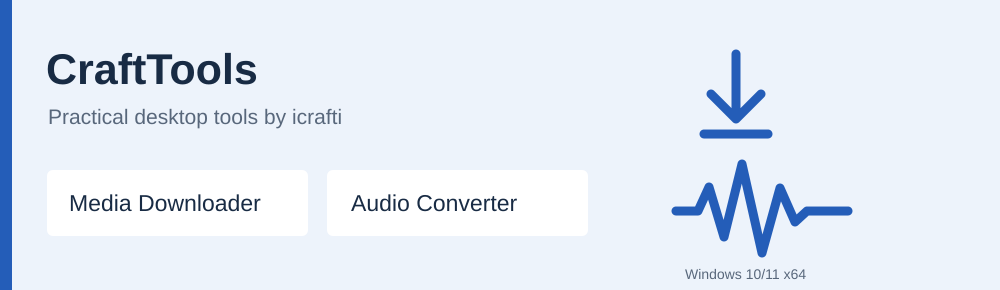

<p align="center"></p>

# CraftTools

Practical Windows desktop tools by **[icrafti](https://github.com/icrafti)**.
Download media, convert audio, and keep your everyday workflow simple.


## Choose your tool

| Tool | What it does | Get started |
| --- | --- | --- |
| **[Media Downloader](apps/media-downloader/README.md)** | Download video or audio from websites supported by yt-dlp; download torrents from magnet links and `.torrent` files. | [Guide](apps/media-downloader/README.md) · [Windows downloads](https://github.com/icrafti/CraftTools/releases) |
| **[Audio Converter](apps/audio-converter/README.md)** | Convert local audio to MP3, WAV, FLAC, M4A/AAC, or OGG/Vorbis. Choose quality, track progress, and cancel safely. | [Guide](apps/audio-converter/README.md) · [Windows downloads](https://github.com/icrafti/CraftTools/releases) |

## Portable Windows applications

1. Open **[Releases](https://github.com/icrafti/CraftTools/releases)** and download the tool you need.
2. Keep the executable with the supplied `LICENSE`, `ATTRIBUTION.md`, and third-party notices, or download its complete portable ZIP.
3. Double-click the executable. No application installer or Python installation is needed.

Both interfaces are in English. Audio Converter works offline. Media Downloader
requires internet access and may need an installed Node.js or Deno runtime for
some websites. Website availability and authentication requirements can change.

## Author credit is required

Original code and collection content are provided under the **[Icrafti
Attribution License 1.0](LICENSE)**. Retain the author credit whenever you use,
modify, or redistribute them. Public uses and publications of processed or
downloaded files must include the credit in an accompanying description,
documentation, or credits:

> Software by icrafti — https://github.com/icrafti/CraftTools

Private use does not require announcing private activity: keeping the built-in
credit and documentation is sufficient. See [Attribution](ATTRIBUTION.md) for
examples and [Third-party notices](THIRD_PARTY_NOTICES.md) for dependency terms.
Earlier MIT/GPL releases retain their original permissions.

## Source and development

```text
apps/
  media-downloader/    Python + Tkinter application
  audio-converter/     C# + Windows Forms application
.agent/
  scripts/             Build tools
  tests/               Automated checks
docs/                  Build instructions, provenance, screenshots
licenses/              Third-party and historical licenses
```

Read the **[build guide](docs/BUILDING.md)** to build either portable executable.
The [test report](docs/TESTING.md) records what was actually checked.
User settings, cookies, downloaded media, and personal recordings are excluded
from this repository.

## Feedback

Use [Issues](https://github.com/icrafti/CraftTools/issues) for bugs and
suggestions. Include the application version, Windows version, and reproduction
steps. Remove personal data, account cookies, and private URLs from reports.

This collection is maintained by icrafti. Download and process only content you
are entitled to use.
