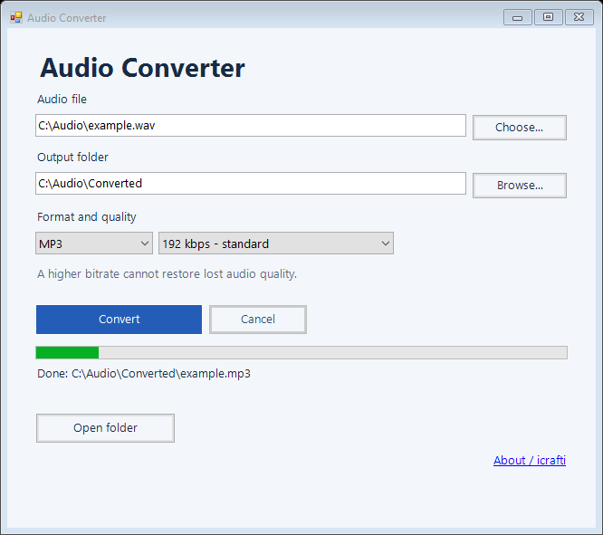

# Audio Converter

A portable audio converter for **Windows 10/11 x64**, by **icrafti**.
One window, five output formats, and no internet connection needed.

## Use

1. Download `AudioConverter.exe` or its portable ZIP from [Releases](https://github.com/icrafti/CraftTools/releases).
2. Open the application and choose or drop an audio file.
3. Choose an output folder, format, and quality, then click **Convert**.
4. When conversion finishes, click **Open folder**.

Supported output formats:

| Format | Encoder | Quality setting |
| --- | --- | --- |
| MP3 | LAME | 96, 128, 192, 256, or 320 kbps |
| WAV | 16-bit PCM | Uncompressed |
| FLAC | FLAC | Lossless compression of the decoded source |
| M4A | AAC | Selected target bitrate |
| OGG | Vorbis | Variable bitrate, approximately the selected quality |

The first audio track is converted. The source recording is preserved.
Existing outputs are not overwritten: a numeric suffix is added to a duplicate
name. Cancelling removes the unfinished conversion file. A higher bitrate cannot
recover quality that was already lost in the source.

## Requirements

- Windows 10/11 x64 with its standard .NET Framework 4.x.
- About 225 MB of temporary space for the bundled FFmpeg engine, plus output space.
- No separate Python, FFmpeg installation, administrator rights, or network access.

FFmpeg is extracted into a unique temporary folder for conversion, run as a
separate process, and removed afterward. The application executable remains
portable; keep the license and notices with redistributed copies.

## Build and license

See the [build guide](../../docs/BUILDING.md#audio-converter).
The English collection version is **1.1**. Original application code uses the
[Icrafti Attribution License 1.0](../../LICENSE); the separate FFmpeg engine
retains GPL v3+ and its own copyright notices.

**Software by icrafti — https://github.com/icrafti/CraftTools**
